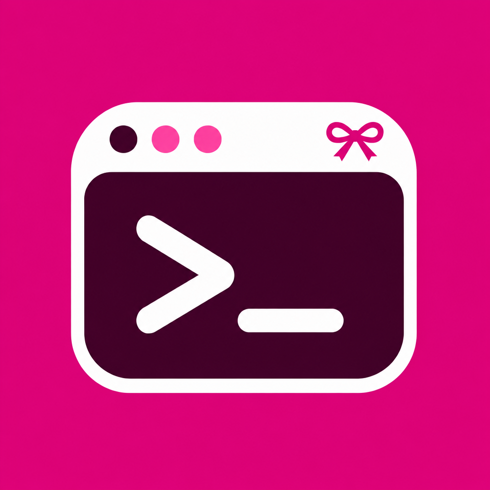
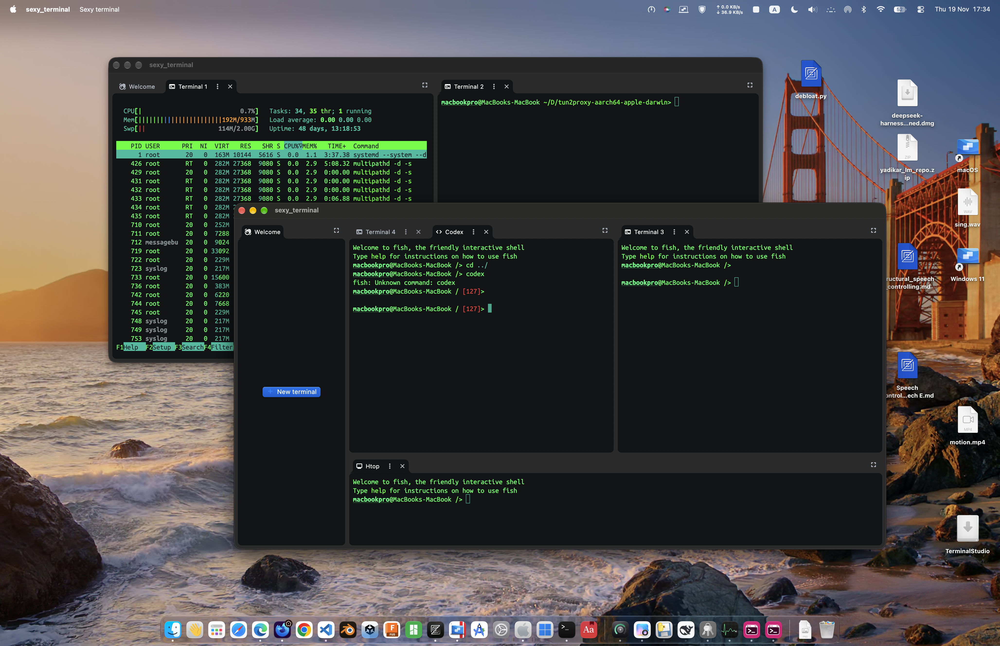
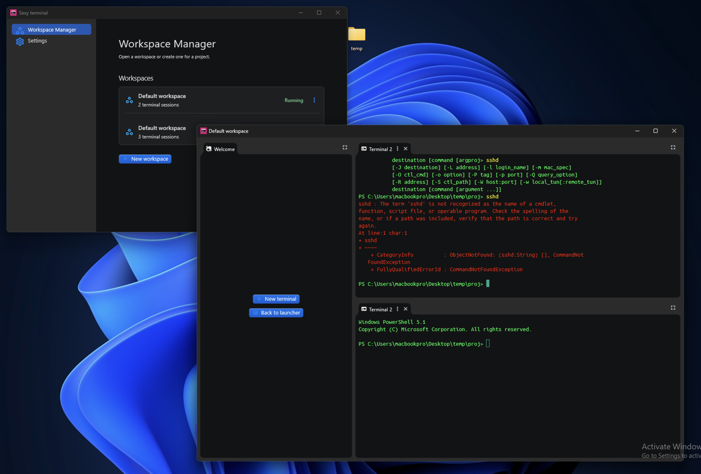
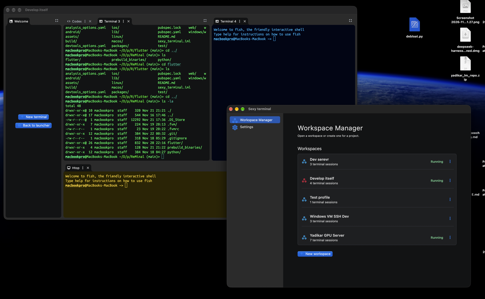
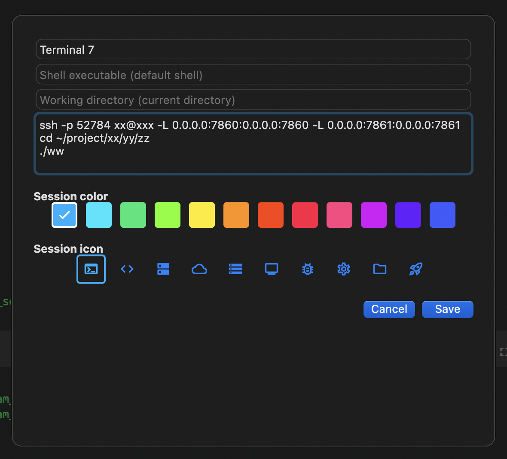
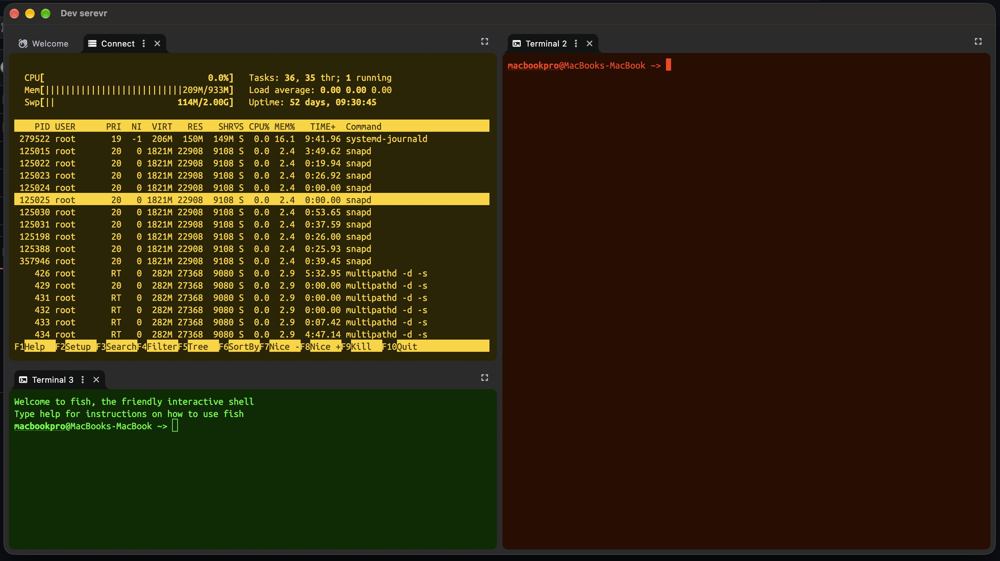

  

<h1 align="center">Sexy Terminal</h1>

A Flutter desktop terminal workspace for organizing repeatable project workflows.

Sexy Terminal combines dockable terminal panels with workspace profiles, so each project can reopen with its familiar terminal layout, sessions, and startup commands.

## Features

- **Native Flutter desktop app:** No webviews and no Electron. Sexy Terminal uses the GPU through Flutter's Impeller engine while keeping binary size and runtime resource consumption small. Your battery should be used for meaningful work.
- **No tied AI models:** The terminal stays focused on terminal workflows and does not lock you into a built-in AI model.
- **Private by default:** Zero telemetry, no account required, and all data stored locally on your device.
- **Native multi-window workspaces:** Run multiple windows and workspaces, each with its own settings and layout.
- **1,000+ built-in color themes:** Customize every workspace and terminal session with a large collection of themes.
- **Randomized docking layouts:** Create varied workspace layouts with dockable, splittable, and tabbed terminal panels.
- **Reliable session workflows:** Restart terminal sessions when an SSH connection gets stuck.
- **Automatic startup commands:** Run a configured sequence automatically when a dock or workspace starts. This is useful for repeatable workflows such as remote development, model training, and monitoring.
- **Persistent terminal sessions** while switching tabs.
- **Named and colorized sessions** with per-session shells and working directories.
- **Native file drag-and-drop support** for terminal workflows.

## Screenshots

  
  

  
  

  

## Usage

See [USAGE.md](USAGE.md) for workspace profiles, terminal sessions, and startup command examples.

## Why this project exists

AI is useful, but it is not needed everywhere. Many terminal applications use Electron or webviews to render a command-line interface, and some require an account. Sexy Terminal is built for people who want a focused native terminal without those dependencies, while still having multi-window workspaces, randomized docking layouts, and automatic startup commands.

## Questions and answers

### Will Sexy Terminal integrate AI agents or AI models?

Not at this time, and there are no plans to add built-in coding agents. If you need an AI coding agent, use a dedicated tool such as `codex-cli`, OpenCode, or Pi alongside Sexy Terminal.

### Why Flutter?

The first implementation used PySide6 and Python. The retained-model GUI approach made the terminal interface more complex to build, and it did not offer a clear performance or resource-usage advantage over current Flutter. Flutter provides a strong native desktop foundation with GPU-accelerated rendering through Impeller, so Sexy Terminal was rebuilt with Flutter.

Made with Flutter and ❤️

## License

See [LICENSE](LICENSE) for details.
